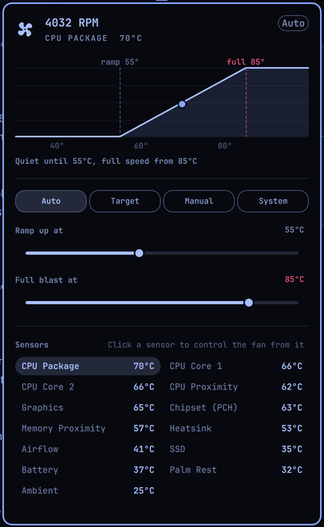

# Fan Control

Fan control for Omarchy on the **2017 13" MacBook Pro without Touch Bar
(MacBookPro14,1)**, in the spirit of Macs Fan Control. That machine has one
`applesmc` fan ("Exhaust", 1200–7200 rpm), and Apple's own control lets the CPU
sit in the high 80s before the fan does much.



> **Hardware:** built and tested on a MacBookPro14,1 only. The installer refuses
> other models unless you pass `--force`. Other Intel Macs with a single
> `applesmc` fan may work, but the sensor list is specific to this model. T2 Macs
> are not supported.

## Modes

| Mode | What the fan does |
|------|-------------------|
| **Auto** | Sensor-based curve: fan minimum until **Ramp up at**, then a straight line to maximum at **Full blast at**. |
| **Target** | Holds the chosen sensor at **Hold at** with a PI loop. The hold temperature always stays at least 5°C below full blast. |
| **Manual** | Constant speed. |
| **System** | Hands the fan back to Apple's SMC (the stock behaviour). |

**Full blast at** applies in Auto, Target and Manual: if the control sensor
crosses it, the fan goes to maximum until the sensor drops 3°C below it. In those
modes the CPU package reaching **95°C** also forces maximum, whichever sensor is
selected. If the sensor can't be read, the fan runs at maximum.

Click any sensor in the panel to make it the control sensor. The default is CPU
Package, smoothed so short spikes don't make the fan surge.

## Install

### From the Omarchy plugin marketplace

1. Add **Fan Control** from the marketplace (or `omarchy plugin add https://github.com/jimg4/fan-control --enable`).
   This installs the bar widget only. Until the next step it shows "Fan service isn't running".
2. **One-time manual setup:** install the root service that talks to the SMC:

   ```bash
   sudo ~/.config/omarchy/plugins/dimef.fan-control/daemon/install-system.sh
   ```

   Read the script first if you like; it is short. It installs `/usr/local/bin/fanctl`,
   `/etc/systemd/system/fan-control.service`, and `/etc/fan-control/config.json`, then
   enables and starts the service.

### From a clone

```bash
git clone https://github.com/jimg4/fan-control && cd fan-control
./install.sh     # sudo for the service, then links the plugin and adds it to the bar
```

## Remove

```bash
sudo ~/.config/omarchy/plugins/dimef.fan-control/daemon/uninstall-system.sh   # add --purge to delete /etc/fan-control
omarchy plugin remove dimef.fan-control
```

Stopping or removing the service always hands the fan back to Apple's SMC. From a
clone, `./uninstall.sh [--purge]` does both steps.

## Dependencies and permissions

- **Runtime:** Omarchy (Quattro shell), `python3` (standard library only), systemd, and the
  in-kernel `applesmc` driver. No network access, no telemetry.
- **Root service:** `fan-control.service` runs `fanctl daemon` as root. It is the only
  thing that writes the SMC (`pwm1_enable`, `fan1_target` on the `applesmc` hwmon device).
  It runs under systemd sandboxing (read-only system, no network, no home directory access).
  `ExecStopPost` hands the fan back to the SMC after any stop, including a crash.
- **Settings without a password:** `/etc/fan-control/` is owned by root. Only
  `config.json` inside it is writable by group `wheel` (users who can already `sudo`).
  The bar plugin changes settings by running `fanctl set` as you. The daemon never
  follows a symlink for that file and never blocks on it. It accepts only a regular
  file and clamps and validates every value.
- **Live state:** the daemon writes `/run/fan-control/state.json` (world-readable)
  once a second. The plugin reads it and treats it as untrusted input.

## How it fits together

```
bar plugin (Panel.qml, as you)
   │  reads  /run/fan-control/state.json
   │  runs   /usr/local/bin/fanctl set <key> <value> ...  → /etc/fan-control/config.json
   ▼
fanctl daemon (root, fan-control.service, 1 Hz)
   writes pwm1_enable / fan1_target on the applesmc hwmon device
```

## CLI

```bash
fanctl status                       # fan, mode, every sensor
fanctl mode auto|target|manual|system
fanctl set ramp 55 blast 85         # several settings at once
fanctl set target 70                # Target mode temperature
fanctl set rpm 3000                 # Manual mode speed
fanctl set sensor cpu-proximity     # see `fanctl sensors`
```

Keybinding-friendly IPC: `omarchy-shell dimef.fan-control toggle` and
`omarchy-shell dimef.fan-control mode manual`.

## Bar widget options

Show the temperature or RPM next to the icon:

```bash
omarchy bar set dimef.fan-control label temp   # or: rpm, none
```

Scrolling over the bar icon changes the speed in Manual mode and the target in Target
mode. The icon turns red during full blast.

## Development

```bash
python3 -m unittest discover -s tests   # daemon: config, curve, PI loop, config-file safety, fake sysfs
node --test tests/                      # panel model, including markup-shaped input
sudo daemon/install-system.sh           # reinstall the service after changing fanctl.py
omarchy-shell shell rescanPlugins       # reload a symlinked plugin after QML edits
```

## License

[MIT](LICENSE) © 2026 jimg4
